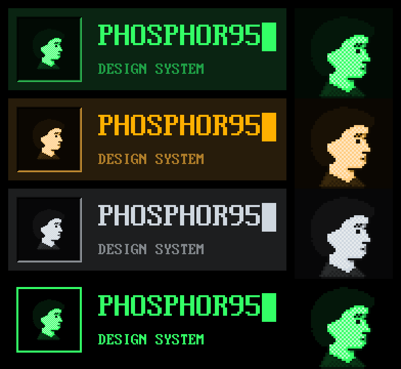

# ▓ Phosphor95

Win95 structure on a green phosphor CRT, as one design system for the web and the terminal.
Extracted from the Phosphor-95 GNOME theme (a separate project), and used by TERMINAL-01. The persona
is the Operator, the pixel head shown as the profile avatar on the lock screen. Prefix: `p95-`.



```sh
python3 tools/build.py            # validate tokens, contrast-gate, build dist/ + contrast report
python3 tools/build.py --check    # validate + contrast only
python3 tools/gen_ramps.py        # regenerate colour ramps, ANSI sets, avatar colours (after editing it)
python3 tools/brand.py            # regenerate brand/logo/ (needs Pillow)
(cd packages/tui/p95-style && cargo test --all-targets)   # Rust crate + TUI gallery render test
python3 -m unittest discover -s tools/tests
```

The token build needs only `python3` ≥ 3.11 (stdlib). `brand.py` also needs Pillow. Build output goes
to `dist/` (git-ignored).

## Themes

| `data-theme` | |
|---|---|
| `green` (default) | P1 green phosphor: exactly the Phosphor-95 desktop |
| `amber` | P3 amber phosphor. Warnings move to white |
| `white` | P4 white phosphor. Real green, amber and red are reserved for status |
| `hc` | High contrast: green on true black, no dim steps, flat bright edges |

Every theme passes the same contrast gate. Results are in
[foundations/contrast.generated.md](foundations/contrast.generated.md).

## Layout

| Path | What |
|---|---|
| `tokens/` | **Source of truth.** DTCG 2025.10 JSON: `primitive/` → `semantic/base.json` + `semantic/themes/*` → `component/*`. `manifest.json` layers them into themes, and `checks.json` is the contrast gate |
| `brand/` | Persona, voice, logo, imagery. `logo/` is generated; `source/` holds the avatar masters |
| `foundations/` | Principles; color, type, space, bevels, motion, effects, icons, accessibility |
| `components/` | Component specs with web and TUI renderings |
| `assets/` | Fonts (with licenses) and the curated icon subset |
| `tools/` | `build.py` and the `p95/` pipeline, `gen_ramps.py`, `import_palette.py`, `brand.py`, tests |
| `packages/web` | `@phosphor95/web`: CSS in cascade layers, classless base, components, effects, Web Components. See its [README](packages/web/README.md) |
| `packages/tui` | Terminal color schemes (8 formats × 4 themes, plus dircolors) and the `p95-style` Rust crate for ratatui. See its [README](packages/tui/README.md) |
| `docs/` | Gallery site dogfooding the web package (`python3 tools/build.py site`, then serve `dist/site`; `?selftest` runs the component tests) |

**Editing tokens:** change JSON in `tokens/`, then run `tools/build.py`. It fails on a broken alias,
a wrong type or a contrast regression. The ramps (`primitive/color-ramps.json`, `color-ansi.json`)
are generated: edit `tools/gen_ramps.py` and re-run it. `primitive/color-source.json` is the
GNOME theme's palette imported verbatim (`tools/import_palette.py`), kept for provenance.

The plan and phases are in [PLAN.md](PLAN.md). Third-party licenses are in [LICENSES.md](LICENSES.md).
