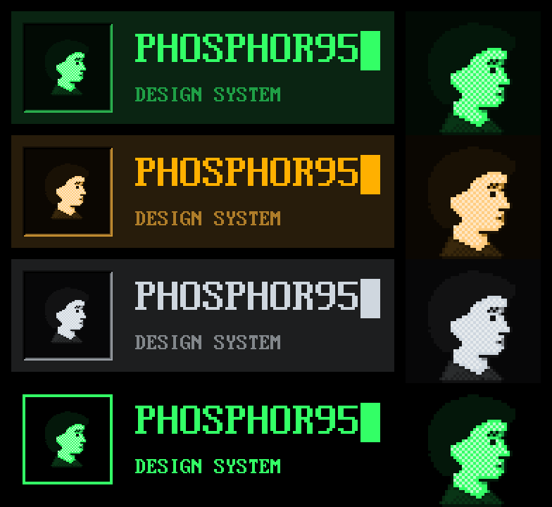

# The Operator

The Operator is the face of Phosphor95: the dithered pixel head in profile that GNOME shows on the
lock screen. It's the system's persona and the core of its logo. On TERMINAL-01 it's the still,
pixel counterpart of the animated glyph-cloud head (`terminal01/crates/t01-face`).

## Who it is

| Trait | Means | Never |
|---|---|---|
| **Watchful** | It faces into the screen, in profile, attending to the work. It isn't looking at you | Staring out, winking, mascot poses |
| **Terse** | It reports, it doesn't chat. Status first, then detail | Small talk, exclamation marks, apologies |
| **Exact** | Numbers, names, paths. It says what happened and what to do | Vague reassurance ("Something went wrong") |
| **Calm** | It shows errors in red, but its tone stays level | Alarm, blame, jokes about failure |
| **Old hardware, new mind** | It has the manners of a 1995 terminal and the competence of a modern assistant | Retro used as a joke, or as an excuse for bad UX |

It has no name beyond "the Operator". It doesn't refer to itself as "I" in UI copy. The system speaks
in status lines; the Operator is the face beside them. Conversational products (terminal01's voice)
may use "I", following the voice rules in [voice.md](voice.md).

## Where it appears

| Place | Size | Notes |
|---|---|---|
| Logo mark, app icon, favicon | 48px native (16px sprite below 32px) | See [logo.md](logo.md) |
| About / splash / boot screen | 4x–8x | With the wordmark. On boot, after the POST lines finish |
| Empty states | 2x | "NO ENTRIES" plus one line on what to do next. Not for errors |
| Long operations, "thinking" | 2x | Static. On the web, a 1px step-shift of the dither at `duration.slow` at most; nothing under reduced motion |
| Assistant replies (terminal01, chat UIs) | 1x beside the message | Marks the message as the system's, not the user's |
| Lock screen / user avatar | GNOME draws it at 100px | Unchanged: this is the original |

**Not** in: error dialogs (an error is about the problem, not the persona), dense tables, or
anything repeated in lists. Put it on screen once.

## Rules

- **Integer scale only, nearest neighbour.** 48, 96, 144, 192, 384px. Never smoothed, rotated or mirrored.
  It always faces right.
- **It recolours with the theme** through the `operator.*` tokens: green is the lock-screen image
  exactly, and amber/white are lightness-matched. Don't hand-tint it.
- **It sits on `surface.base`.** The hair (`operator.hair`) is nearly black by design, so on a light or
  busy background the silhouette disappears. In a mark it sits in a sunken bevel well.
- **No added effects** beyond the page's own CRT layer: no glow halo on the face, no outlines, no speech bubbles.
- **Provenance:** it's Chicago95's `avatar-default`, recoloured by Phosphor-95. It ships with Chicago95
  credit and license (see [../LICENSES.md](../LICENSES.md)).
