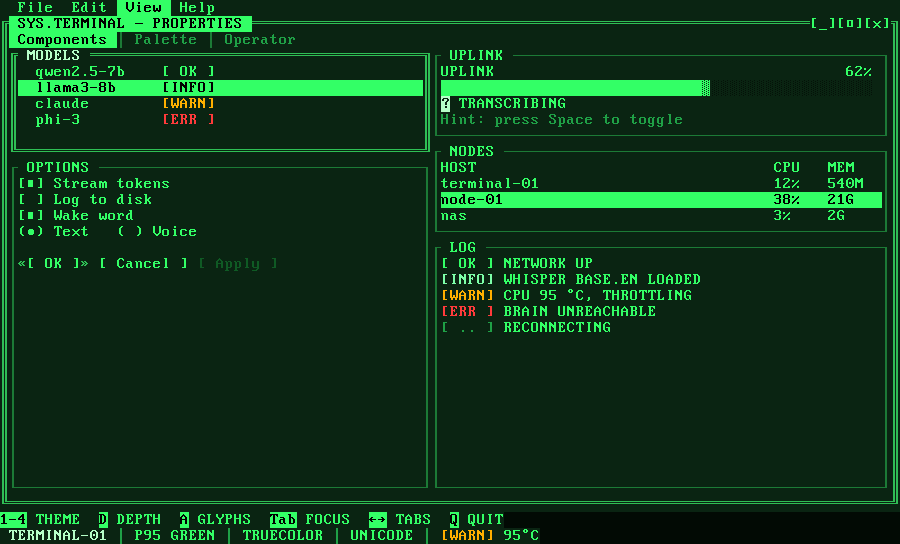
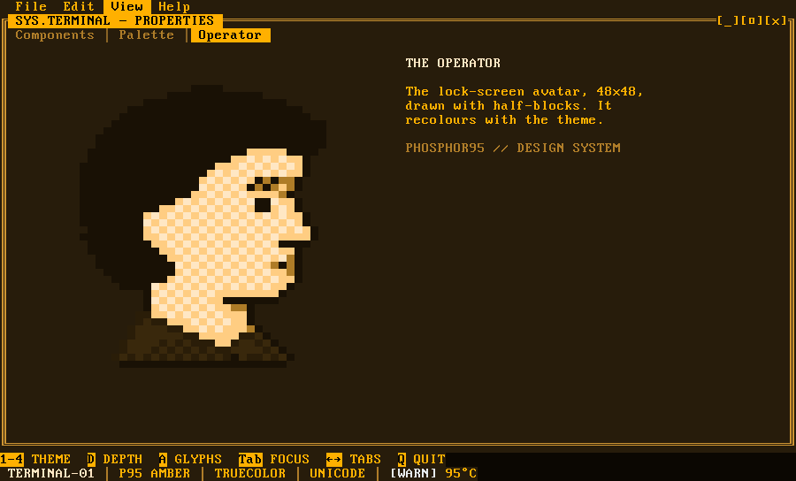
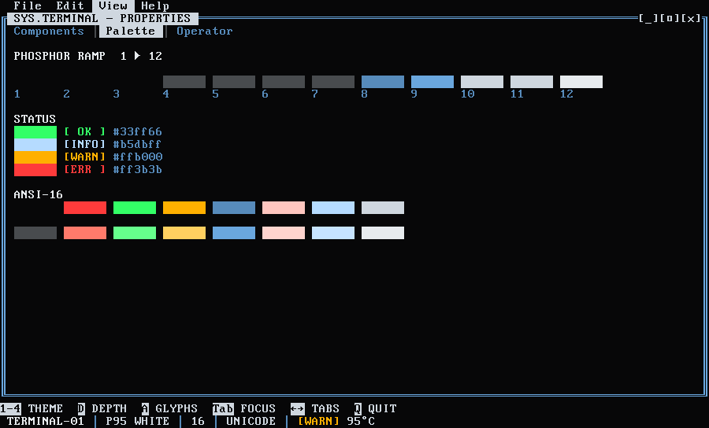
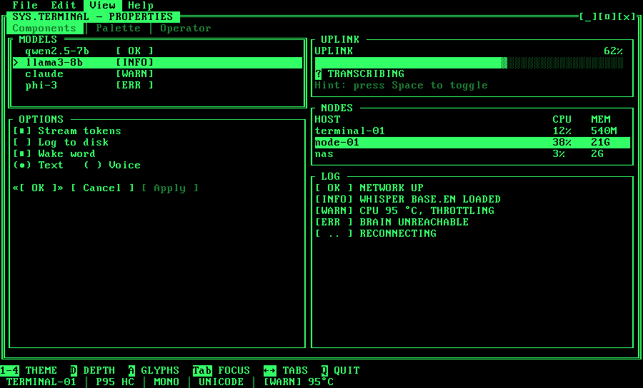
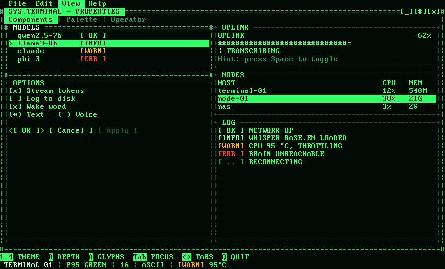

# Phosphor95 for terminals

Two deliverables: **terminal color schemes** and the **`p95-style` Rust crate** for ratatui apps.
Both are generated from `tokens/` by `python3 tools/build.py tui`. Rules for CLIs and TUIs are in
[foundations/cli.md](../../foundations/cli.md).



## Terminal color schemes: `terminal-themes/`

There's one file per theme (`green`, `amber`, `white`, `hc`) for each of these:

| Terminal | Install |
|---|---|
| Ghostty | Copy `ghostty/phosphor95-<theme>` to `~/.config/ghostty/themes/`, then set `theme = phosphor95-green` |
| Kitty | `include phosphor95-green.conf` in `kitty.conf` |
| Alacritty | `[general] import = ["…/alacritty/phosphor95-green.toml"]` |
| WezTerm | Put the file in `~/.config/wezterm/colors/`, then set `config.color_scheme = "Phosphor95 Green"` |
| foot | `[main] include=…/foot/phosphor95-green.ini` |
| Windows Terminal | Paste the JSON into `"schemes"`, then set `"colorScheme": "Phosphor95 Green"` |
| iTerm2 | Preferences → Profiles → Colors → Import… `iterm2/phosphor95-green.itermcolors` |
| base16 tools | `base16/phosphor95-<theme>.yaml` |
| `ls` colors | `eval "$(dircolors -b phosphor95.dircolors)"` |

The green Ghostty scheme matches the Phosphor-95 desktop's terminal exactly. Background, foreground,
cursor and selection come from `surface.base`, `text.primary`, `text.hot` and `select.*`. The 16 colors
are `ansi.*`.

## `p95-style`: the Rust crate

```toml
[dependencies]
p95-style = { path = "…/packages/tui/p95-style" }                          # with ratatui (default)
# p95-style = { path = "…", default-features = false }                     # palettes + env + glyphs only
```

```rust
use p95_style::{Env, Level, Theme};

let theme = Theme::from_env(&Env::detect());        // NO_COLOR, COLORTERM, TERM, locale, P95_*
let block = theme.panel("Models", true);            // focused pane: double border
let line  = theme.status_line(Level::Warn, "cpu 95 °c");   // [WARN] CPU 95 °C
let hints = theme.key_hints(&[("F1", "Help"), ("^Q", "Quit")]);
let bar   = theme.progress(0.62, 32);               // whole-cell bar, fill + track styles
```

| Module | What |
|---|---|
| `Palette`, `GREEN` `AMBER` `WHITE` `HC`, `THEMES` | Generated: 171 colors per theme, named after token paths (`text_secondary`, `window_titlebar_active_bg`, `phosphor_10`…). Each is a `Swatch` with `r g b`, `x256` (nearest xterm-256 by OKLab distance) and `ansi` (nearest entry in the theme's own 16 colors) |
| `duration::*` | Motion tokens in ms (`BLINK`, `FAST`, `TICK`…) |
| `Env`, `ColorDepth` | Detection and the `P95_*` switches (see cli.md) |
| `glyphs` | `ASCII`, `UNICODE`, `NERD_FONT` tiers: status icons, checks, radios, arrows, tree, spinner, progress cells, and the `panel`/`focused` border sets |
| `Level` | `Ok Info Warn Error Pending`, with fixed 6-character tags and `fg(palette)` |
| `operator::OPERATOR_48` | The lock-screen avatar as a role grid; `style::Operator` draws it with half-blocks |
| `style::Theme` (feature `ratatui`) | Semantic styles (`text`, `secondary`, `hot`, `selected`, `title_active`, `status`, `key`…) and widget bundles (`panel`, `window`, `button`, `check`, `radio`, `tabs`, `progress`, `spinner`, `key_hints`, `status_bar`, `status_line`) |

How each color depth degrades:

| Depth | Behavior |
|---|---|
| TrueColor | Exact token colors, panel backgrounds included |
| 256 | Precomputed nearest xterm-256 color |
| 16 | The theme's ANSI index. With the matching scheme installed, these *are* the theme. Panel backgrounds are left to the terminal; meaningful backgrounds (selection, title, key caps) stay |
| Mono | No color escapes. Selection uses reverse video, hot uses bold, secondary and disabled use dim, links are underlined, and the focused pane keeps its double border |

## Gallery

```sh
cd packages/tui/p95-style
cargo run --example gallery                                   # 1-4 theme · d depth · a glyphs · Tab · ←→ · q
cargo run --example gallery -- --snapshot --theme amber --depth 256 --size 100x34   # print one frame as ANSI
cargo run --example gallery -- --snapshot | python3 ../../../tools/ansi2png.py - out.png --theme green
cargo test --all-targets      # incl. a render test over 4 themes x 4 depths x 2 glyph tiers x 3 tabs
```

| | |
|---|---|
|  |  |
|  |  |

The screenshots are rendered by `tools/ansi2png.py` with PxPlus IBM VGA 9x16. That font has no braille, so the spinner shows as a placeholder there; real terminals use your own font.
